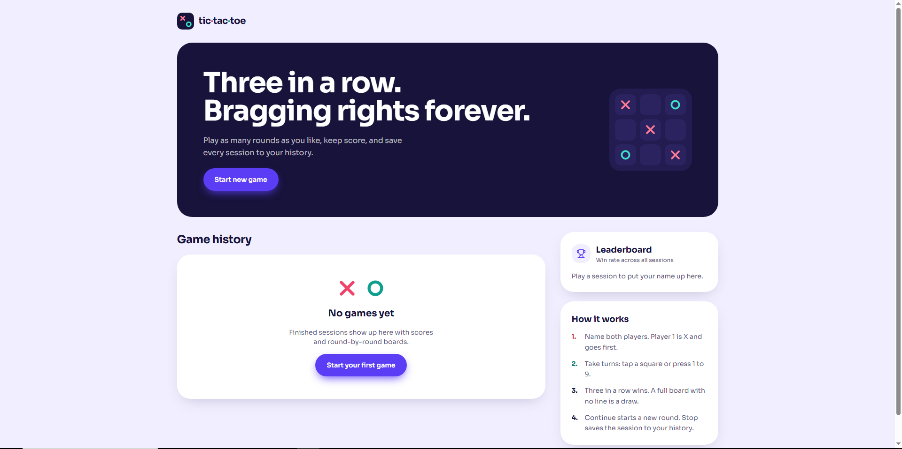
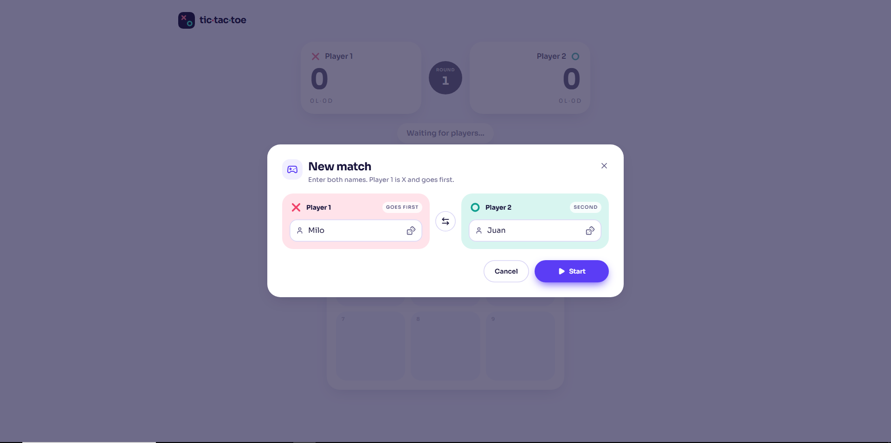
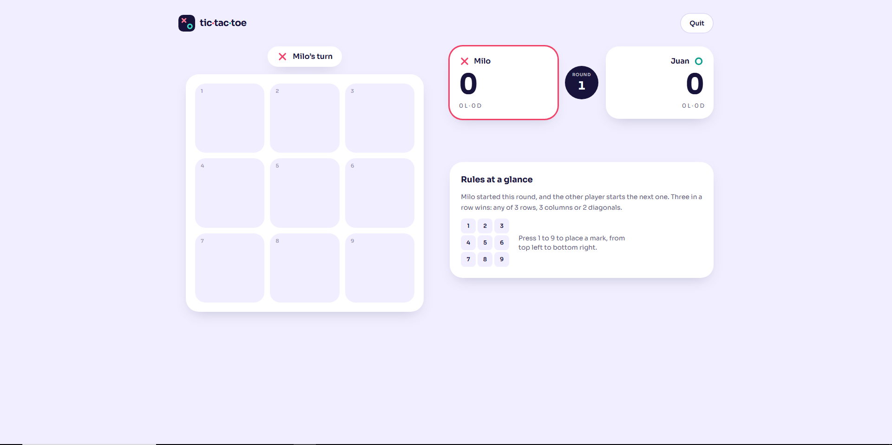
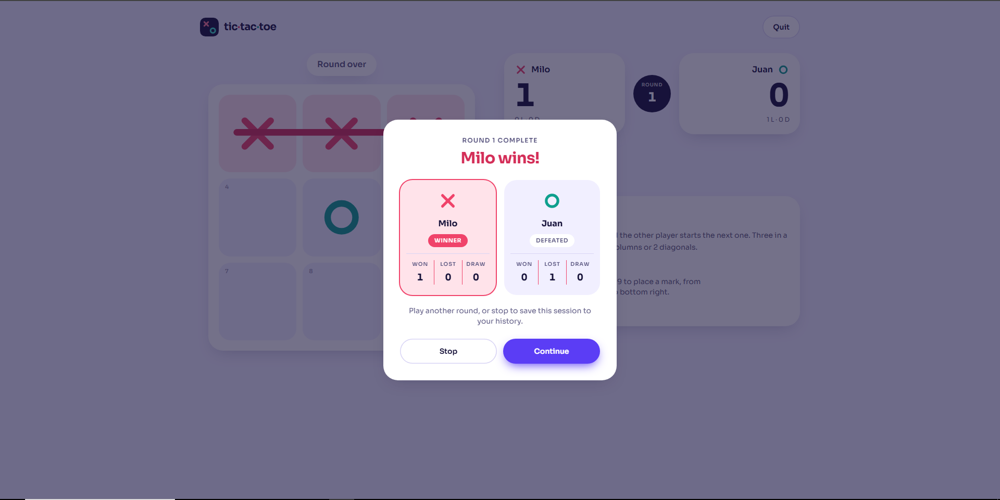
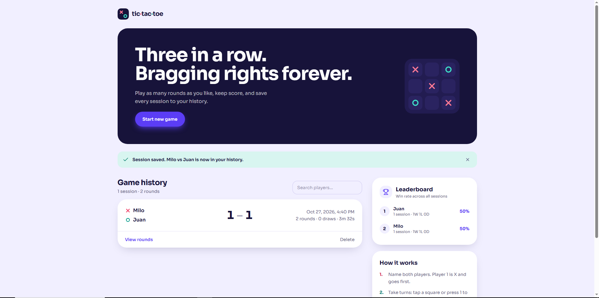

# Tic Tac Toe

A full-stack Tic Tac Toe game where two players can play as many rounds as they want, and every finished session gets saved to a history page so you can look back at who won.

<p>
  
  
  
  
  
</p>

The idea is simple: let two players enter their names, play rounds, and save the results. I wanted to go a bit further than the minimum, so I added a few things that make it nicer to actually play and a bit more solid under the hood.

---

## Preview

| Home (history) | Gameplay | Round over |
| :---: | :---: | :---: |
|  |  |  |
---

## What it does

When you open the app, you land on a history page that lists every saved game: who played, the final score, how many rounds and draws there were, how long it took, and when it happened. From there you hit **Start New Game**, type in both player names, and start playing.

Each round updates a live scoreboard. When a round ends, you choose **Continue** to play another one, or **Stop** to save everything to the database and head back home. The player who goes first switches every round, so it stays fair.

A few things I'm happy with:

- **It feels good to play.** The X and O marks are drawn with a hand-drawn animation, a line strikes through the winning row, and there's confetti when someone wins. All of it respects `prefers-reduced-motion`.
- **You can play with the keyboard.** Press `1` to `9` to place a mark. The tiles are real buttons with ARIA labels, so it works with screen readers too.
- **Refreshing won't lose your game.** Unfinished sessions are kept in localStorage, and you can resume or discard them.
- **There's a leaderboard.** It ranks the top players across all sessions, matching names case-insensitively, so "milo" and "Milo" count as the same person.
- **History is easy to dig into.** You can search by player, expand any session to see a round-by-round breakdown with a small board thumbnail, and delete a session after a confirmation prompt.
- **The server doesn't trust the client.** When a session is saved, the backend recomputes the wins, losses, draws and overall winner from the round results, so the totals can't be faked.
- **It fails gracefully.** There are loading skeletons, and if the API is down you get a clear error with a retry option instead of a blank page.

---

## Tech stack

| Layer | What I used |
| --- | --- |
| Frontend | Next.js 15, TypeScript, Tailwind CSS 3 |
| Backend | Express 5, TypeScript, Mongoose, Zod |
| Database | MongoDB |
| Testing and checks | node:test, ESLint, TypeScript typecheck |

The frontend and backend are separate apps. The frontend runs on port 3000 and talks to the Express API on port 5000.

---

## Getting started

You'll need Node 18 or newer and a MongoDB instance. If you have Docker, the included compose file gives you one in a single command.

**1. Clone the repo**

```bash
git clone https://github.com/CrissanDondriano/tic-tac-toe.git
cd tic-tac-toe
```

**2. Start MongoDB**

```bash
docker compose up -d
```

This starts MongoDB on `localhost:27017`. If you already have MongoDB running, you can skip this and point the backend at it instead.

**3. Run the backend**

```bash
cd backend
cp .env.example .env
npm install
npm run dev
```

The API will be available at `http://localhost:5000/api`. The default `.env` already works with the Docker setup.

**4. Run the frontend** (in a second terminal)

```bash
cd frontend
cp .env.local.example .env.local
npm install
npm run dev
```

Open `http://localhost:3000` and you're in.

For a production build, run `npm run build && npm start` in each folder.

### Configuration

| File | Variable | Default |
| --- | --- | --- |
| `backend/.env` | `PORT` | `5000` |
| | `MONGODB_URI` | `mongodb://127.0.0.1:27017/tictactoe` |
| | `CORS_ORIGIN` | `http://localhost:3000` (comma-separated for several) |
| `frontend/.env.local` | `NEXT_PUBLIC_API_URL` | `http://localhost:5000/api` |

---

## How to use it

1. Open the app and click **Start New Game**.
2. Enter a name for Player 1 and Player 2, then press **Start**.
3. Take turns clicking tiles, or press `1` to `9` on your keyboard.
4. When the round ends, pick **Continue** for another round or **Stop** to save.
5. Back on the home page, your session is in the history and the leaderboard has updated.

### Using the API directly

If you want to poke at the backend yourself, the base URL is `http://localhost:5000/api`.

| Method | Path | What it does |
| --- | --- | --- |
| GET | `/health` | Checks that the server is running |
| GET | `/games` | Lists saved sessions, newest first. Accepts `search` and `limit` (up to 500) |
| GET | `/games/:id` | Returns one session |
| POST | `/games` | Saves a finished session |
| DELETE | `/games/:id` | Deletes a session |
| GET | `/leaderboard` | Returns the top 10 players by round wins |

Here's an example of saving a session:

```bash
curl -X POST http://localhost:5000/api/games \
  -H "Content-Type: application/json" \
  -d '{
    "player1": "Milo",
    "player2": "Ben",
    "startedAt": "2026-10-27T01:00:00.000Z",
    "rounds": [
      {
        "winner": "player1",
        "startingPlayer": "player1",
        "moves": 5,
        "board": ["X", "X", "X", "O", "O", "", "", "", ""]
      }
    ]
  }'
```

If the data is invalid, the API responds with a `400` and a list of what went wrong, like `{ "error": "Validation failed", "details": [{ "path", "message" }] }`.

### Running the tests

```bash
cd backend && npm test
cd backend && npm run typecheck
cd frontend && npm run lint && npm run typecheck
```

---

## How the project is organized

```
backend/src
  config/        environment variables
  middleware/    error handling
  models/        Mongoose schema
  routes/        games and leaderboard endpoints
  services/      stats logic (with tests)
  validation/    Zod request schemas

frontend
  app/           pages
  components/    UI components
  hooks/         custom React hooks
  lib/           API client, game logic and session state
```

---

## Status and what's next

The project is complete. Everything in the core game works, along with the extras above.

If I keep building on it, these are the things I'd add:

- Player accounts, so history belongs to a user
- Online multiplayer
- A single-player mode against an AI opponent
- Bigger boards, like 4x4 and 5x5
- Deployment with CI that runs lint, typecheck and tests on every push

---

## About me

I'm Crissan, a full stack web developer. If you'd like to talk about this project or work together, you can find me here:

- GitHub: [github.com/CrissanDondriano](https://github.com/CrissanDondriano)
- LinkedIn: [linkedin.com/in/crissan-dondriano-862862316/](https://www.linkedin.com/in/crissan-dondriano-862862316/)